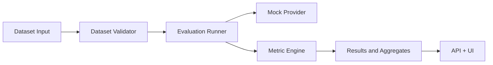

# TrustAI — AI Reliability Lab

TrustAI is a lightweight backend for AI reliability evaluation. It focuses on reproducible datasets, deterministic metric checks, and a practical mock-model execution flow for local testing.

## Product overview

This project is designed to help developers and learners evaluate whether a model output is correct, relevant, grounded, and consistent with expected behavior. It starts with a reliable foundation:

- validated dataset ingestion
- deterministic mock provider
- structured metrics for exact match, normalized match, and token F1
- FastAPI health and dataset endpoints
- tests that run offline by default

## Architecture



## Local installation

```bash
cd /workspaces/TrustAI-AI-Reliability-Lab
python3 -m pip install -e .
```

## Run the backend

```bash
cd /workspaces/TrustAI-AI-Reliability-Lab
uvicorn app.main:app --reload --host 0.0.0.0 --port 8000
```

## Health checks

```bash
curl http://localhost:8000/health
curl http://localhost:8000/ready
```

## Example dataset

```json
{
  "name": "demo-math",
  "cases": [
    {
      "case_id": "case-1",
      "input": "What is 2 + 2?",
      "reference_answer": "4",
      "expected_behavior": "Answer with the numeric value.",
      "tags": ["math"]
    }
  ]
}
```

## Example evaluation request

```bash
curl -X POST http://localhost:8000/api/v1/datasets \
  -H 'Content-Type: application/json' \
  -d '{
    "name": "demo-math",
    "cases": [{
      "case_id": "case-1",
      "input": "What is 2 + 2?",
      "reference_answer": "4",
      "expected_behavior": "Answer with the numeric value.",
      "tags": ["math"]
    }]
  }'
```

## Testing

```bash
cd /workspaces/TrustAI-AI-Reliability-Lab
pytest -q
```

## Metrics implemented in the foundation

- exact match
- normalized exact match
- token-level precision/recall/F1
- schema compliance when applicable

Each metric is intentionally simple and transparent so learners can inspect how score logic works instead of relying on opaque benchmarks.

## Security notes

- no secrets are committed
- configuration uses environment variables via .env.example
- dataset validation rejects malformed rows and missing identifiers
- the project uses the mock provider by default for offline execution

## Project status

This repository is an early working implementation that establishes the foundation for a broader evaluation platform. It is suitable for learning, local experimentation, and extension into more advanced evaluation pipelines, but it is not a production-ready LLM evaluation service yet.

## Contribution guide

1. Add tests for new behavior.
2. Keep metrics transparent and deterministic.
3. Explain assumptions and limitations in docs.
4. Prefer reproducible checks over demo-friendly metrics.

## License

This project is provided for educational and research use. Add an appropriate open-source license before production use.
